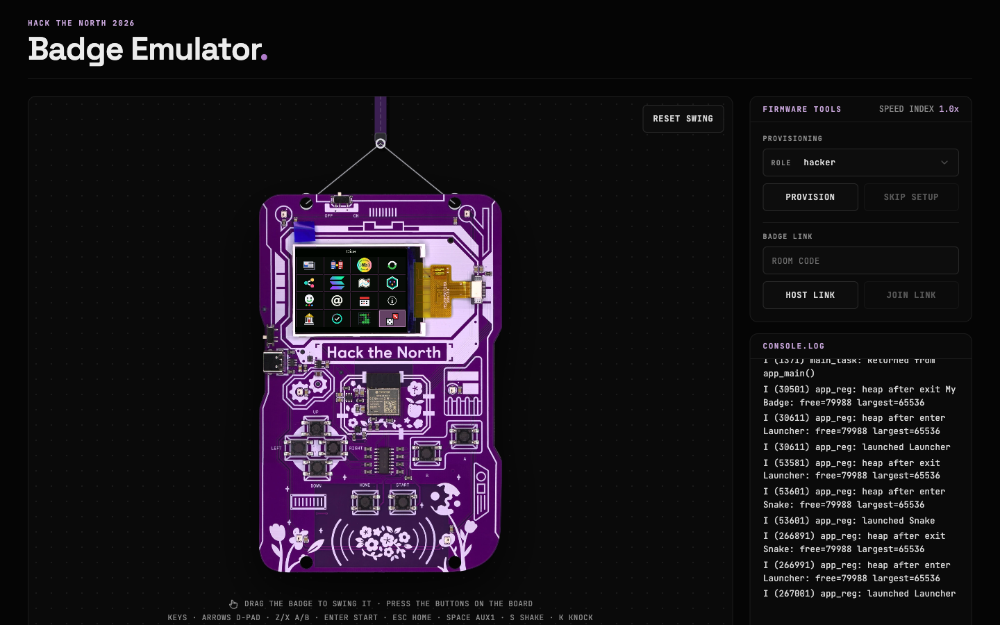
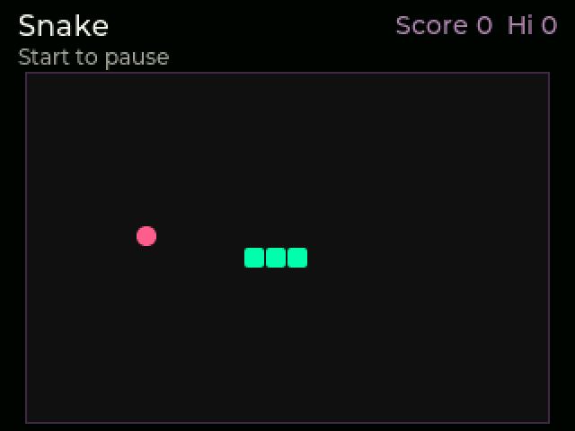
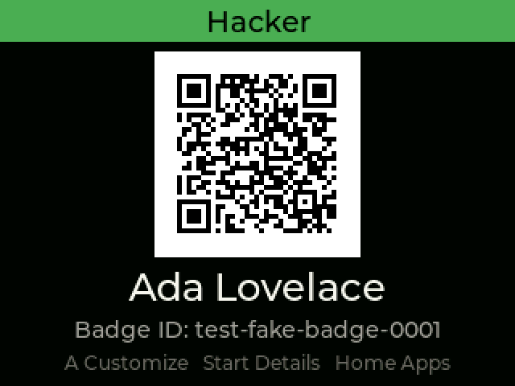
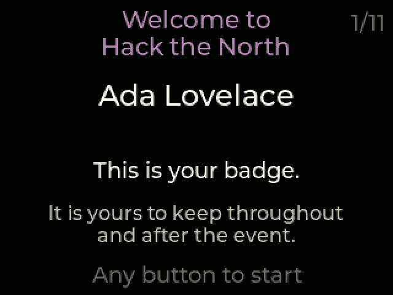
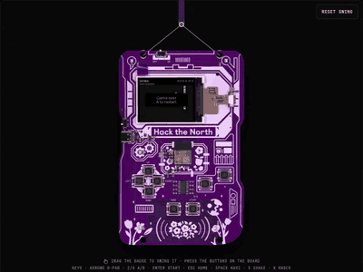

# Hack the Badge

A browser emulator for the Hack the North 2026 hacker badge, an ESP32-C3
board with an ST7789 screen, six WS2812 LEDs, a D-pad and an accelerometer.

The page does not reimplement the badge's apps. It runs the badge's official
firmware (`v0.1.2-392-gd3089c4`) on an ESP32-C3 emulator written from scratch
in Rust: an RV32IMC core plus the peripherals the firmware uses. The emulator
is compiled to WebAssembly and runs in a Web Worker, paced to wall-clock time.



## Demos

<table>
  <tr>
    <td align="center"><br>Snake</td>
    <td align="center"><br>The launcher</td>
  </tr>
  <tr>
    <td align="center"><br>Skip setup (it reboots the badge)</td>
    <td align="center"><br>Knock (K) and shake (S) on the lanyard</td>
  </tr>
</table>

Everything on the screen is drawn by the real firmware. The identity shown
("Ada Lovelace", `test-fake-badge-0001`) is one of the fake test identities.

## What you can do

- **Press the buttons** on the photo of the board, or use the keyboard:

  | Key        | Badge          |
  | ---------- | -------------- |
  | Arrow keys | D-pad          |
  | Z / X      | A / B          |
  | Enter      | START          |
  | Escape     | HOME           |
  | Space      | AUX1 switch    |
  | S / K      | shake / knock  |

- **Swing the badge** on its lanyard by dragging it. The swing and the tilt
  feed the emulated accelerometer, so "Shake it!" passes when you shake it.
  On a phone you can turn on "Use phone motion" and use the phone's own
  motion sensor instead.
- **Flip the power switch** for a cold boot. The flash is kept, so a
  provisioned badge boots back to its registered screen.
- **Provision** a fake test identity (FIRMWARE TOOLS → PROVISIONING). The
  page types the commands into the badge's own USB console. **Skip setup**
  skips the 11-page onboarding app.
- **Open any of the launcher's 16 apps**: Snake, Dice, Connect, Sync and
  the rest.
- **Link two badges** (BADGE LINK → Host / Join) across two browsers on the
  same network over WebRTC. Bump them together by swinging each into a wall,
  and Connect pairs them. The firmware's Bluetooth runs on a fake BLE
  controller inside the emulator.
- **Read CONSOLE.LOG**, the badge's USB serial output.

## Known limitations

- The browser can't advertise real BLE, so an emulated badge only hears
  other emulated badges. Sync ends on "No sync station in range".
- The WASM core runs about 41M steps/s; the real chip does 80M. Most apps
  play at full speed, but heavy redraws run slower than on the badge.
- Two things are best guesses, not checked against a physical badge: which
  LED in the chain sits where on the board, and the accelerometer's axis
  signs.

See [`docs/firmware-emulator-notes.md`](docs/firmware-emulator-notes.md),
in particular its "Timing model" and "Known limitations" sections.

## Getting started

You need [Bun](https://bun.sh), and for the emulator, `rustup` with the
`wasm32-unknown-unknown` target and
[`wasm-pack`](https://rustwasm.github.io/wasm-pack/).

```sh
bun run install:frontend   # install the web app's dependencies
bun run build:wasm         # build the emulator into frontend/src/cpu/wasm-pkg/
bun run dev                # http://localhost:5173
```

Re-run `bun run build:wasm` after any change under `emulator-core/` or
`emulator-wasm/`. Nothing else rebuilds it.

To link two devices on your network, serve the LAN with
`bun run dev -- --host`.

Use Bun for all JS/TS work; don't use npm, yarn or pnpm. The scripts in the
root `package.json` forward to `frontend/`, so they work from either
directory.

| Command                 | What it does                                   |
| ----------------------- | ---------------------------------------------- |
| `bun run dev`           | Dev server (also `/bench.html`, `/api/signal`) |
| `bun run build`         | Production build to `frontend/dist/`           |
| `bun run preview`       | Serve that build on port 4173                  |
| `bun test`              | Frontend unit tests                            |
| `bun run typecheck`     | `tsc --noEmit`                                 |
| `bun run bench:wasm`    | WASM redraw benchmark                          |

### Rust

Run these from the repo root. The integration tests also need the
`riscv32imc-unknown-none-elf` target.

```sh
cargo test -p emulator-core                                  # fast unit tests
cargo test -p emulator-core --release --test boot_progress   # real-firmware boot ratchet
cargo test --workspace                                       # everything, in debug
cargo clippy --workspace --all-targets
```

The boot ratchet boots `firmware.bin` and checks each step along the way: a
console line, a point reached without a fault, or a hash of the screen.

When boot gets stuck, the boot probe prints console output, hot PCs and
unmapped accesses:

```sh
cargo run -p emulator-core --release --example boot-probe -- --steps 20000000 --dump-frame frame.png
```

A relative `--dump-frame` path is written under `local/`.

## Layout

```
emulator-core/   Pure-Rust emulator: RV32IMC core, memory map, peripherals,
                 mask-ROM stubs, the fake BLE controller, FirmwareRuntime
emulator-wasm/   Thin wasm-bindgen shim over emulator-core
frontend/        Vite + React + Tailwind v4 (shadcn/ui) web app, matter.js
                 lanyard physics, the Worker runtime, WebRTC badge links
frontend/api/    /api/signal, the Vercel function for WebRTC signaling
docs/            The documentation (index: docs/README.md): handoff,
                 architecture, development guide, history, the emulator
                 notes and per-milestone design decisions
```

[`CLAUDE.md`](CLAUDE.md) has a file-by-file architecture map and the
project's rules. [`docs/README.md`](docs/README.md) indexes the docs; start
with [`docs/handoff.md`](docs/handoff.md) for the state the project ended in.
The project wrapped up on 2026-11-15, after Milestone 14.

## How it works

- **Shortcut boot.** The emulator loads the app image straight from
  `firmware.bin` and skips the ROM and the bootloader. High-level stubs
  stand in for the mask-ROM functions the firmware calls.
- **Peripherals.** SYSTIMER, the interrupt matrix, GPIO with the 74HC165
  button shift register, SPI2 driving the ST7789 framebuffer, GDMA, TIMG,
  RTC_CNTL, USB-Serial-JTAG (the console), I2C with the SC7A20H
  accelerometer, RMT with a passive WS2812 decoder for the LEDs, and the
  flash and its MMU.
- **Resets.** Five apps start by rebooting the badge. A software reset
  takes the badge's 466 ms and keeps what a real CPU reset keeps.
- **Radio.** The firmware's Bluetooth stack talks to a fake LE controller,
  hooked in at the firmware's VHCI boundary. Advertisements go between
  browsers over WebRTC data channels with no STUN or TURN server; the only
  server is the small signaling mailbox at `/api/signal`.

## Data

`frontend/public/firmware/firmware.bin` is the official firmware image,
fetched from <https://badge.hackthenorth.com/firmware/firmware.bin>. The test identities in
`frontend/public/firmware/test-identities/` and the upload token are fake.
Never commit a real attendee's identity, a credential, or a full flash dump.
`local/` is gitignored for that reason.

## License

[GPL-3.0](LICENSE).
